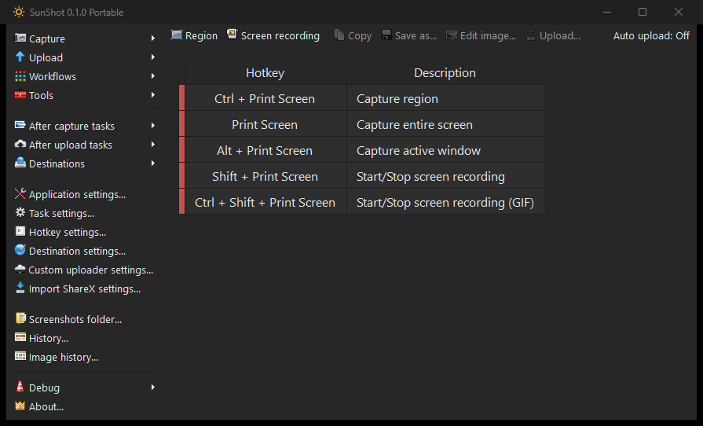

<p align="center">
  
</p>

<h1 align="center">SunShot</h1>
<p align="center">A clean screen capture and recording app.</p>
<p align="center">
  <a href="https://github.com/SunSinD/SunShot/releases/latest">Download</a> &middot;
  <a href="docs/MIGRATION.md">Move from ShareX</a> &middot;
  <a href="CHANGELOG.md">What's new</a> &middot;
  <a href="https://github.com/SunSinD/SunShot/issues">Feedback</a>
</p>
<p align="center">
  <a href="https://github.com/SunSinD/SunShot/releases/latest"></a>
  <a href="LICENSE.txt"></a>
</p>

Capture your screen, add annotations, and copy, save or share the result. Built on **ShareX 21.0.0**, SunShot keeps the familiar menus and tools, with a compact toolbar and its own settings and updates.

<p align="center">
  
</p>

## Get SunShot

Download the [latest release](https://github.com/SunSinD/SunShot/releases/latest) for **Windows 11 22H2 or newer, x64**. The .NET runtime is included.

| Download | Getting started |
| --- | --- |
| **Installer** (`*-setup-x64.exe`) | Run the installer, then open SunShot. |
| **Portable** (`*-portable-x64.zip`) | Extract to a writable folder and open `SunShot.exe`. Keep the whole folder together. |

SunShot is an early beta. Downloads are unsigned, so Windows may show a publisher warning.

## Make it yours

- **Capture** regions, windows, full screens and scrolling pages.
- **Record** video or GIFs. Download FFmpeg when you first need it.
- **Edit** with arrows, text, shapes, blur and other annotation tools.
- **Keep your workflow** with custom hotkeys, capture history and task settings.
- **Choose your look** with light and dark themes and translations, including French.

New profiles start in English and copy and save screenshots locally. Automatic update checks start off. Uploading is optional: configure your destination first. Services needing application keys are not preconfigured; custom uploaders and your own credentials remain available.

## Moving from ShareX

Choose **Import ShareX settings** in the main window and select your ShareX profile folder, usually `Documents\ShareX`.

The published **0.1.0 release accepts ShareX 21.0 settings**. The upcoming **0.1.1 release also accepts 22.0 through 22.4**, with a compatibility report before importing. Common settings carry over; newer tools, native recording and themes have limits explained in the report.

SunShot backs up its current profile, copies the settings and restarts. Your ShareX files are preserved. Uploading, hotkeys, external actions and watch folders stay disabled until you review them. Close ShareX before enabling the same global shortcuts in SunShot.

See [migration](docs/MIGRATION.md) for supported versions, what carries over and how to turn features back on.

## Build and contribute

Use the .NET 10 SDK on Windows:

```powershell
dotnet build SunShot/ShareX.csproj -c Release -p:Platform=x64 --self-contained true --source https://api.nuget.org/v3/index.json
```

To package a clean, committed checkout, run `./build/Package.ps1`. Packaging also needs Inno Setup 6.5 or newer, available through `-IsccPath`.

Bug reports, testing and C#/WinForms contributions are welcome. Development is AI-assisted.

[Testing](docs/TESTING.md) | [Privacy](docs/PRIVACY.md) | [Third-party software](docs/THIRD-PARTY.md)

## Credits and license

Based on [ShareX 21.0.0](https://github.com/ShareX/ShareX/tree/v21.0.0), by the ShareX team and contributors. SunShot is an independent project by **SunSinD**, unaffiliated with ShareX. Original copyright notices, translations and third-party licenses are preserved.

Licensed under [GPL-3.0](LICENSE.txt).
